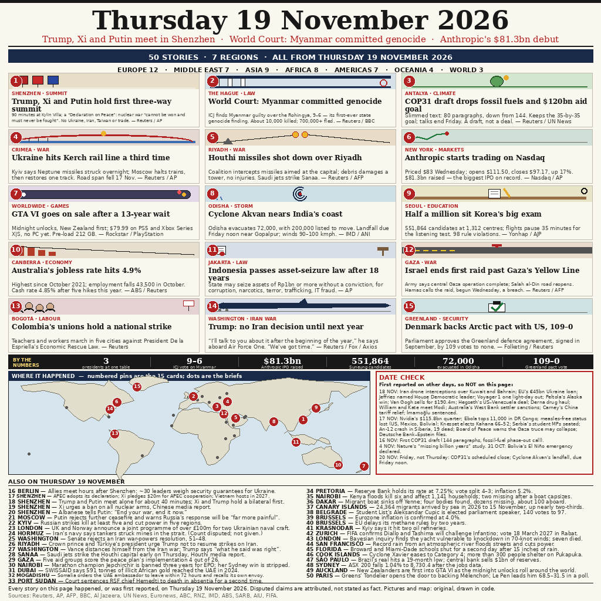

# Thursday 19 November 2026 — The World in One Image

[](https://make.fun/bounty/news-image-20261119)
[](https://make.fun/bounty/news-image-20261119)
[](https://make.fun/bounty/news-image-20261119)

One 1024×1024 broadsheet summing up the world news of Thursday 19 November
2026: 50 stories across 7 regions — 15 numbered illustrated cards, a world
map with numbered pins for every card, a "by the numbers" strip, a DATE
CHECK box naming tempting stories left out because they belong to other days,
and 35 one-line briefs. The lead stories are the first-ever Trump–Xi–Putin
three-way summit in Shenzhen, the World Court's genocide finding against
Myanmar, and Anthropic's record $81.3bn Nasdaq debut. Every pictured event
happened, or was first reported, on 19 November 2026; disputed claims are
attributed in the headlines. All pictures and the map are original, drawn in
code — no photographs.



## Run it

```sh
# the entrypoint: copies entry.png to the output directory
node main.ts
# redraw the image from scratch (needs Pillow)
python3 draw.py
```

`main.ts` (Node 22, standard library only) copies `entry.png` to
`$MAKEFUN_OUTPUT_DIR` (default `/output`), validating the PNG magic bytes
and the 1 MiB size limit. `draw.py` renders the broadsheet with Pillow: the
masthead, the region tally computed from the story data, the 15 flat-drawn
cards, the polygon world map projected from lon/lat, the numbers strip, the
DATE CHECK box, the 35 briefs and the sources footer. See `STORIES.md` for
every story, figure and source.

## make.fun

Built for the [news-image-20261119](https://make.fun/bounty/news-image-20261119)
competition on [make.fun](https://make.fun) — "Sum up 19 November's world
news in one image".
